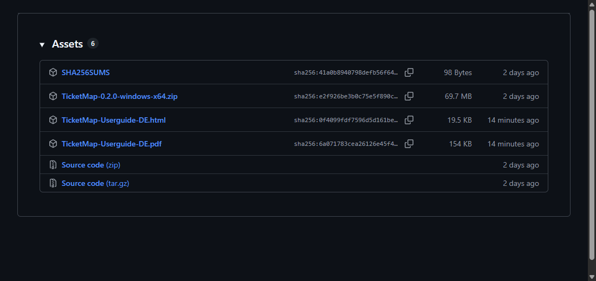
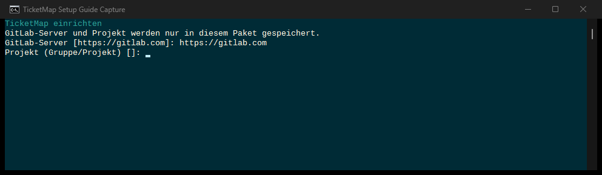
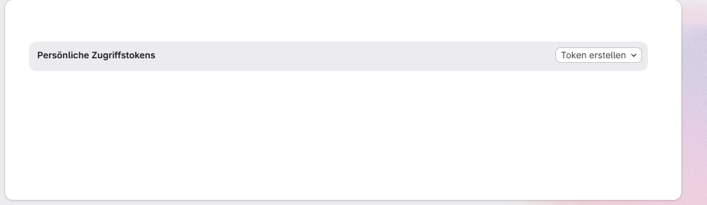
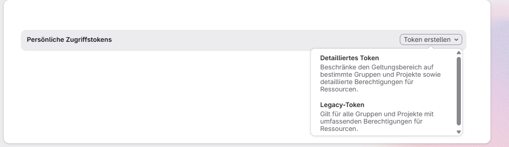
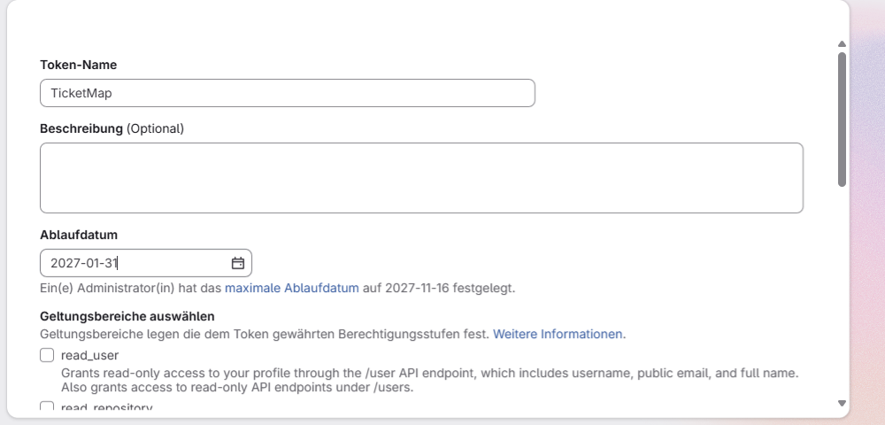
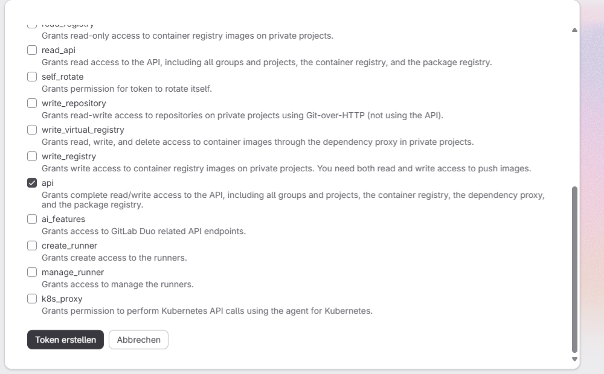
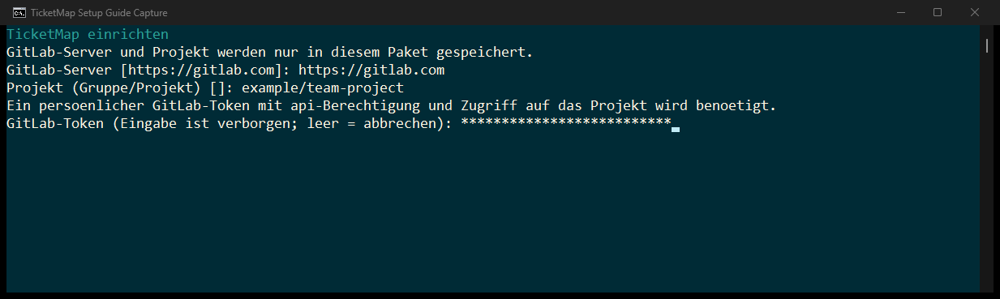
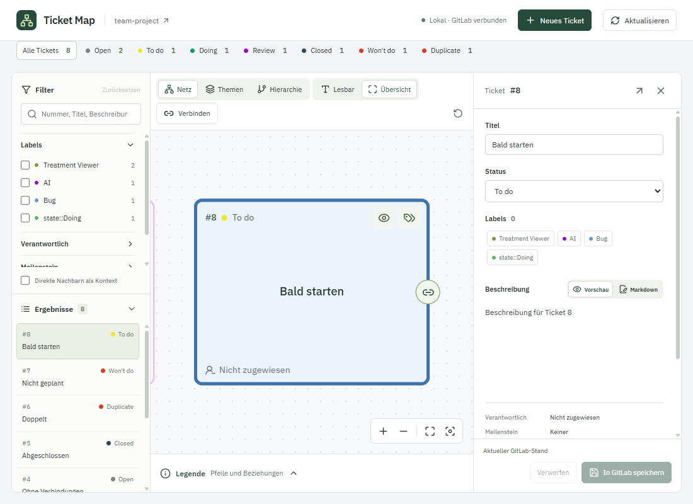

# TicketMap: Schritt-für-Schritt-Anleitung mit Originalaufnahmen

Diese Anleitung gilt für die portable Windows-x64-Version ab 0.2.0. Sie zeigt die Einrichtung und die Token-Eingabe in einzelnen Schritten. Die Originalaufnahmen enthalten keine privaten Kontoinformationen oder echten Tokenwerte.

Die [Offline-HTML-Anleitung](user-guide/guide.html) enthält die freigegebenen Bilder eingebettet. Öffne sie im Browser und wähle bei Bedarf **Drucken → Als PDF speichern**.

## 1. Das Windows-Paket herunterladen

*Echte Aufnahme der öffentlichen TicketMap-Release-Seite.*

Du brauchst Windows 64-Bit, einen Browser, Internetzugang und Zugriff auf dein GitLab-Projekt. Node.js und GitLab CLI sind enthalten. npm musst du nicht installieren.
<ol><li>Öffne <a href="https://github.com/0siris/TicketMap/releases/latest">TicketMap unter GitHub Releases</a>.</li><li>Lade unter <strong>Assets</strong> die Datei <code>TicketMap-&lt;version&gt;-windows-x64.zip</code> herunter.</li></ol>
Wähle nicht <strong>Source code (zip)</strong>. Das ist der Quellcode, nicht das startfertige Paket.

## 2. Alle Dateien entpacken und starten

<ol><li>Öffne deinen Download-Ordner.</li><li>Klicke die ZIP-Datei mit der rechten Maustaste an und wähle <strong>Alle extrahieren</strong>.</li><li>Entpacke das ganze ZIP in einen beschreibbaren Ordner.</li><li>Öffne den entpackten Ordner <code>TicketMap</code>. Doppelklicke <strong><code>TicketMap.cmd</code></strong>.</li></ol>
Falls Windows die Dateiendungen ausblendet, suche <strong>TicketMap</strong> vom Typ <strong>Windows-Befehlsdatei</strong>. Die Dateien <code>ConfigureTicketMap.cmd</code> und <code>StopTicketMap.cmd</code> sind für andere Aufgaben.

Starte nicht aus der ZIP-Vorschau. Behalte <code>app</code>, <code>runtime</code>, <code>licenses</code> und die Startdateien zusammen im entpackten Ordner.

## 3. GitLab-Server und Projekt eingeben

*Originalaufnahme des Startprogramms. Die Eingaben sind Beispiele.*

<ol><li>Öffne dein Projekt im GitLab-Browser. Beispiel: <code>https://gitlab.example.com/example/team-project</code>.</li><li>Gib bei <strong>GitLab-Server</strong> nur den Server ein, im Beispiel <code>https://gitlab.example.com</code>. Drücke <strong>Enter</strong>. Bei GitLab.com kannst du den Vorschlag mit Enter übernehmen.</li><li>Gib bei <strong>Projekt (Gruppe/Projekt)</strong> nur den Projektpfad ein, im Beispiel <code>example/team-project</code>. Drücke Enter.</li></ol>
Untergruppen gehören zum Pfad: <code>example/subgroup/team-project</code>. Zusätze wie <code>/-/issues</code>, eine Ticketnummer oder <code>.git</code> gehören nicht hinein.

Wenn eine passende GitLab-CLI-Anmeldung vorhanden ist, öffnet sich TicketMap ohne Token-Abfrage. Gehe dann zu Schritt 10. Die folgenden Schritte brauchst du, wenn das Startfenster nach einem Token fragt.

## 4. Die persönliche Token-Seite öffnen

*Echte GitLab-Aufnahme. Profilbereiche und vorhandene Tokenlisten sind ausgeblendet.*

<ol><li>Lass das TicketMap-Startfenster geöffnet und wechsle zum Browser.</li><li>Melde dich auf <strong>demselben GitLab-Server</strong> an, den du in TicketMap eingetragen hast.</li><li>Öffne dein Profilbild → <strong>Profil bearbeiten / Edit profile</strong> → <strong>Zugriff / Access → Persönliche Zugriffstokens / Personal access tokens</strong>.</li></ol>
Alternativ hängst du an deine GitLab-Serveradresse <code>/-/user_settings/personal_access_tokens</code> an. Beispiel: <code>https://gitlab.example.com/-/user_settings/personal_access_tokens</code>.

Erzeuge den Token auf deiner eigenen Instanz. Ein Token von GitLab.com meldet dich nicht automatisch an einem anderen GitLab-Server an.

## 5. Einen neuen persönlichen Token auswählen

*Echte GitLab-Browseraufnahme des geöffneten Erstellungsmenüs.*

<ol><li>Klicke <strong>Token erstellen</strong>, in einer englischen Oberfläche zum Beispiel <strong>Generate token</strong>.</li><li>Wenn du einen Typ auswählen sollst, wähle <strong>Legacy-Token</strong>. Danach öffnet sich das Formular <strong>Legacy-Token generieren</strong>.</li></ol>
Bei älteren GitLab-Versionen gelangst du möglicherweise direkt in das Formular oder verwendest <strong>Add new token</strong>. Entscheidend ist ein persönlicher Zugriffstoken mit der Berechtigung <code>api</code>.

Menünamen können je nach Sprache und GitLab-Version abweichen. Die Bilder zeigen aufgenommene Oberflächen, keine nachgebauten Formulare.

## 6. Tokenname und Ablaufdatum eintragen

*Echte Formularaufnahme: Token-Name TicketMap und Ablaufdatum 31.01.2027 sind Beispiele. Wähle dein eigenes gültiges Ablaufdatum; kein Tokenwert wird gezeigt.*

<ol><li>Gib im Feld <strong>Token-Name</strong> zum Beispiel <strong>TicketMap</strong> ein. Der Name hilft dir später, diesen Token wiederzufinden.</li><li>Wähle im Feld <strong>Ablaufdatum</strong> ein Datum in der Zukunft. Beachte die Vorgaben deiner Organisation.</li><li>Eine Beschreibung kannst du ergänzen, wenn GitLab dieses Feld anbietet. Sie ist für die Anmeldung nicht erforderlich.</li></ol>
<strong>Der Name ist noch kein Zugangsschlüssel.</strong> Kopiere später nicht den Namen „TicketMap“ oder eine Token-ID. Du benötigst den langen Tokenwert, den GitLab nach dem Erstellen einmalig anzeigt.

## 7. api auswählen und den Token erstellen

*Echte GitLab-Aufnahme mit der ausgewählten Berechtigung api, ohne private Kontodaten.*

<ol><li>Suche die Liste der <strong>Berechtigungen / Scopes</strong>. Scrolle bei Bedarf nach unten.</li><li>Aktiviere das Kontrollkästchen <strong><code>api</code></strong>. Wähle für diese Anleitung keine zusätzlichen Berechtigungen aus.</li><li>Prüfe den Namen, das Ablaufdatum und das Häkchen bei <code>api</code>.</li><li>Klicke auf die Schaltfläche, die den neuen persönlichen Token erstellt, zum Beispiel <strong>Token erstellen</strong> oder <strong>Generate token</strong>.</li></ol>
Die Berechtigung <code>api</code> ermöglicht TicketMap auch Änderungen über die GitLab-API. Dein Konto muss zusätzlich Zugriff auf das gewünschte Projekt haben. Der Token verleiht keine Projektberechtigungen, die dein Konto nicht besitzt.

Der letzte Klick erzeugt einen neuen Zugangsschlüssel in deinem Konto. Gib diesen Schlüssel nicht weiter.

## 8. Den neuen Tokenwert einmalig kopieren

<ol><li>Nach dem Erstellen zeigt GitLab den <strong>neuen Tokenwert</strong> an.</li><li>Kopiere genau diesen Wert. Verwende die Kopierfunktion neben dem Wert, wenn deine Oberfläche sie anbietet. Falls der Wert verdeckt ist, kopiere nicht die dargestellten Sternchen, sondern benutze die Kopierschaltfläche.</li><li>Lass die GitLab-Seite geöffnet, bis TicketMap deine Anmeldung bestätigt hat.</li></ol>
<strong>Den Wert kannst du später nicht erneut anzeigen lassen.</strong> Wenn du ihn verloren hast, erstelle einen neuen Token. Kopiere nicht den Tokennamen, die Token-ID, einen Feed-Token oder einen Token für eingehende E-Mails.

Der geheime Tokenwert wird hier absichtlich nicht abgebildet. Die Anleitung zeigt weder einen echten Zugangsschlüssel noch einen nachgebauten Ergebnisbildschirm mit einem erfundenen Token.

## 9. Den Token in TicketMap einfügen

*Originalaufnahme der Token-Abfrage mit verdecktem, ungültigem Beispieltext. Die Eingabe wurde nicht abgeschickt.*

<ol><li>Wechsle zurück zum <strong>TicketMap-Startfenster</strong>, das über <code>TicketMap.cmd</code> geöffnet wurde.</li><li>Klicke in dieses Konsolenfenster. Der Cursor muss hinter dieser Abfrage stehen:</li></ol><pre class="input-target"><code>GitLab-Token (Eingabe ist verborgen; leer = abbrechen):</code></pre><ol start="3"><li>Füge den zuvor kopierten Tokenwert mit der Einfügefunktion des Konsolenfensters ein, zum Beispiel <strong>Strg+V</strong> oder über das Kontextmenü <strong>Einfügen</strong>.</li><li>Drücke <strong>Enter</strong> genau einmal.</li><li>Warte, während TicketMap die Anmeldung und den Projektzugriff prüft. Wenn beides stimmt, öffnet sich der Browser automatisch.</li></ol>
Die Eingabe ist verdeckt. Je nach Konsole siehst du Sternchen oder keine Zeichen. Das ist normal. Eine leere Eingabe bricht die Einrichtung ab. Der Token gehört nicht in die Browseradresszeile, ein Suchfeld oder eine Konfigurationsdatei.

TicketMap speichert einen hier eingegebenen Token verschlüsselt für dein Windows-Konto und diesen Rechner. Es speichert nicht dein GitLab-Kontopasswort.

## 10. Prüfen, ob TicketMap die Tickets lädt

*Aufnahme der echten TicketMap-Anwendung mit Beispieldaten, ohne privates Projekt.*

<ol><li>Der Browser öffnet <strong><a href="http://127.0.0.1:4310">http://127.0.0.1:4310</a></strong>. Falls kein Browser aufgeht, öffne die Adresse selbst.</li><li>Prüfe, ob links deine Tickets erscheinen.</li><li>Klicke einen Eintrag links an. Die Map holt die Karte ins Bild und rechts öffnet sich die Ticketansicht.</li></ol>
Wenn GitLab den Zugriff ablehnt, prüfe Server, Projektpfad, Token und Projektberechtigung. Kopiere keine Fehlermeldung zusammen mit einem Token in einen Chat.

## 11. Später starten, stoppen oder die Anmeldung ändern

<ul><li><strong>Erneut starten:</strong> Doppelklicke <code>TicketMap.cmd</code>. Die gespeicherten Einstellungen werden verwendet.</li><li><strong>Beenden:</strong> Speichere oder verwirf offene Ticketänderungen. Starte dann <code>StopTicketMap.cmd</code>. Nur den Browser zu schließen beendet den Server nicht.</li><li><strong>Server, Projekt oder Token ändern:</strong> Starte <code>ConfigureTicketMap.cmd</code>. Sichere vorher ungespeicherte Änderungen. Für einen neuen Token behältst du Server und Projekt bei und bestätigst die Frage nach einer neuen Anmeldung.</li></ul>
Ein abgelaufener Token funktioniert nicht mehr. Erstelle in GitLab einen neuen und gib ihn über <code>ConfigureTicketMap.cmd</code> ein.

Teile den Ordner <code>data</code> nicht. Dort liegen Einstellungen und gegebenenfalls verschlüsselte Zugangsdaten. Auf einem anderen Rechner oder Windows-Konto musst du die Anmeldung neu einrichten.

## 12. Manuell aktualisieren und Probleme lösen

<ol><li>Speichere oder verwirf offene Ticketänderungen und starte <code>StopTicketMap.cmd</code>.</li><li>Lade das neue Windows-ZIP herunter und entpacke es in einen neuen Ordner.</li><li>Kopiere den bisherigen Ordner <strong><code>data</code></strong> in das neue Paket. Kopiere nicht die alten Ordner <code>app</code> oder <code>runtime</code>.</li><li>Starte dort <code>TicketMap.cmd</code>. Behalte Browser, Adresse, Port und GitLab-Projekt bei.</li></ol>
Die Kartenpositionen liegen im Browser. Lösche dessen Website-Daten nicht, wenn du die Anordnung behalten willst. Neue Anwendungsversionen werden nur gemeldet und verlinkt, nicht automatisch installiert.
<table><thead><tr><th>Problem</th><th>Nächster Schritt</th></tr></thead><tbody><tr><td>Anmeldung oder Projekt nicht bestätigt</td><td>Server, Projektpfad, eigenen Zugriff, Ablaufdatum und api-Berechtigung prüfen.</td></tr><tr><td>Tokenwert verloren</td><td>Neuen persönlichen Token erstellen. Der alte Wert kann nicht erneut angezeigt werden.</td></tr><tr><td>Port 4310 ist belegt</td><td>Eine bereits laufende TicketMap über ihr Stop-Skript beenden. Andere Anwendungen nicht ungeprüft schließen.</td></tr><tr><td>Browserseite nicht erreichbar</td><td>TicketMap.cmd starten und Meldung im Startfenster lesen. Bei Firmenrichtlinien die lokale IT einbeziehen.</td></tr></tbody></table>

## Quellen und Bildhinweise

Die Menüfolge wurde mit der [offiziellen GitLab-Dokumentation](https://docs.gitlab.com/user/profile/personal_access_tokens/) abgeglichen. Die Aufnahmen stammen aus Browser und Anwendung. Private Profilbereiche und vorhandene Tokenlisten werden vor der Aufnahme ausgeblendet; Anwendungsdaten sind Beispiele. Kein tatsächlich erzeugter geheimer Tokenwert wird gezeigt.

Die Bilder sind keine nachgebauten Formulare. Deine GitLab-Version kann andere Bezeichnungen zeigen. Die Anleitung ersetzt keinen Test deiner eigenen Anmeldung.
