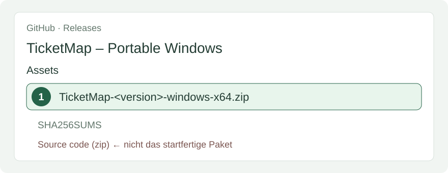
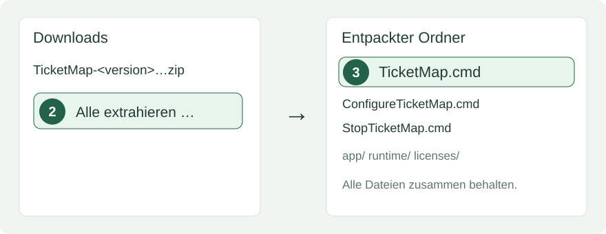
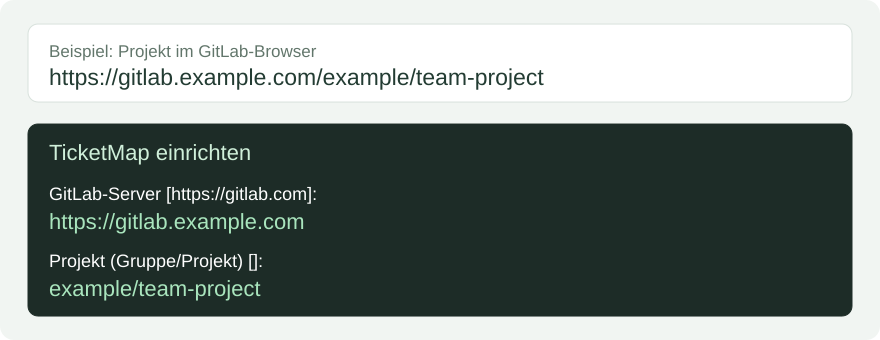
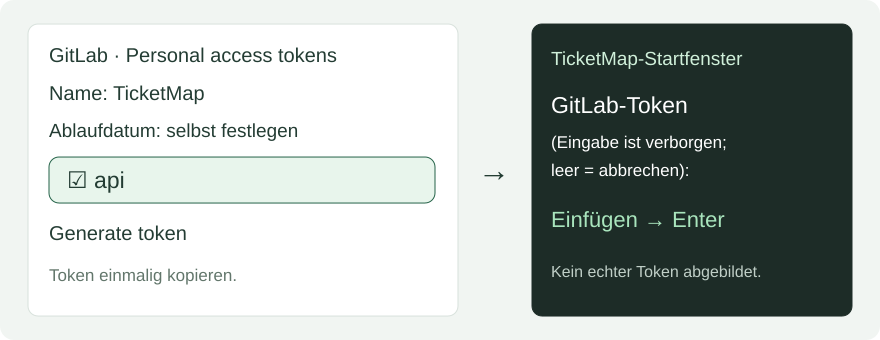
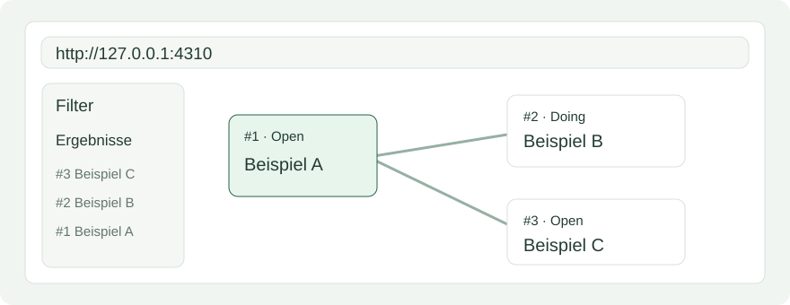
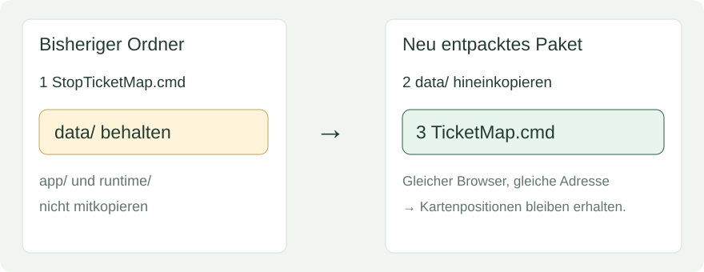

# TicketMap: bebilderter Userguide für Windows

Diese Anleitung ist für neue Nutzer der portablen Windows-x64-Version ab 0.2.0. Die Bilder sind schematische Beispiele
mit fiktiven Daten. Du brauchst Windows 64-Bit, einen Browser, Internetzugang und Zugriff auf dein GitLab-Projekt.
Node.js und GitLab CLI sind bereits enthalten. npm brauchst du für das Paket nicht.

Die [HTML-Anleitung](user-guide/guide.html) enthält alle Bilder eingebettet und kann lokal im Browser geöffnet und
über **Drucken → Als PDF speichern** ausgegeben werden.

## 1. Das richtige Paket herunterladen

Du brauchst <strong>Windows 64-Bit</strong>, einen Browser, Internetzugang und Zugriff auf dein GitLab-Projekt. Node.js und GitLab CLI sind bereits enthalten. npm brauchst du für das Paket nicht.
<ol><li>Öffne die <a href="https://github.com/0siris/TicketMap/releases/latest">GitHub-Releases von TicketMap</a>.</li><li>Öffne die gewünschte Version. Lade unter <strong>Assets</strong> die Datei <code>TicketMap-&lt;version&gt;-windows-x64.zip</code> herunter.</li></ol>
Wähle nicht „Source code (zip)“: Das ist der Quellcode, nicht das startfertige Windows-Paket.

## 2. Entpacken und starten

<ol><li>Öffne den Download-Ordner. Klicke mit der rechten Maustaste auf die ZIP-Datei und wähle <strong>Alle extrahieren</strong>.</li><li>Entpacke alle Dateien in einen Ordner, in dem du Dateien speichern darfst.</li><li>Öffne den entpackten Ordner <code>TicketMap</code> und doppelklicke <strong><code>TicketMap.cmd</code></strong>.</li></ol>
Ein Konsolenfenster für die Einrichtung öffnet sich. Starte die Datei aus dem entpackten Ordner, nicht direkt aus der ZIP-Vorschau. Behalte die Unterordner <code>app</code>, <code>runtime</code> und <code>licenses</code> zusammen mit den Startdateien.

## 3. GitLab-Server und Projekt eintragen

Öffne dein Projekt in GitLab. Die Projektadresse zeigt dir beide benötigten Werte. Die Abbildung verwendet ausschließlich Beispieldaten.
<ol><li>Bei <strong>GitLab-Server</strong> gib nur die HTTPS-Serveradresse ein, z. B. <code>https://gitlab.example.com</code>. Bestätige mit <strong>Enter</strong>. Wenn dein Projekt auf GitLab.com liegt, kannst du den vorgeschlagenen Server mit Enter übernehmen.</li><li>Bei <strong>Projekt (Gruppe/Projekt)</strong> gib den Pfad ein, z. B. <code>example/team-project</code>, und drücke Enter. Untergruppen gehören dazu: <code>example/subgroup/team-project</code>.</li></ol>
Nicht die komplette Browseradresse als Projektpfad einfügen. Zusätze wie <code>/-/issues</code>, eine Ticketnummer oder <code>.git</code> gehören nicht in diese Eingabe.

## 4. Anmelden – falls TicketMap nach einem Token fragt

Eine passende vorhandene GitLab-CLI-Anmeldung wird automatisch verwendet. Dann erscheint keine Token-Abfrage.
<ol><li>Melde dich im Browser an <strong>deinem GitLab-Server</strong> an. Öffne dein Profilbild → <strong>Edit profile</strong> → <strong>Access → Personal access tokens</strong>. Die Bezeichnungen können je nach GitLab-Version abweichen.</li><li>Wähle bei <strong>Generate token</strong> gegebenenfalls <strong>Legacy token</strong>. Vergib einen Namen, z. B. <code>TicketMap</code>, lege ein Ablaufdatum fest und aktiviere <strong><code>api</code></strong>.</li><li>Erzeuge den Token und kopiere ihn sofort. GitLab zeigt den Wert nur einmal an.</li><li>Wechsle zum TicketMap-Startfenster, füge den Token an der Abfrage ein und drücke <strong>Enter</strong>.</li></ol>
Die Eingabe ist verdeckt. Je nach Konsole siehst du Sternchen oder keine Zeichen. Das ist normal. Eine leere Eingabe bricht die Einrichtung ab.

Die <code>api</code>-Berechtigung ist weitreichend. Der Token ist nicht dein GitLab-Kontopasswort. Verwende deinen eigenen Token und gib ihn nicht in Chats, URLs oder Konfigurationsdateien weiter. Dein Konto benötigt zusätzlich Zugriff auf das Projekt. <a href="https://docs.gitlab.com/user/profile/personal_access_tokens/">Offizielle GitLab-Anleitung</a>.

## 5. Im Browser arbeiten und später erneut starten

Nach erfolgreicher Einrichtung öffnet sich dein Standardbrowser mit <strong><a href="http://127.0.0.1:4310">http://127.0.0.1:4310</a></strong>. Die Tickets werden aus dem konfigurierten Projekt geladen. Falls sich kein Browser öffnet, rufe diese Adresse selbst auf.
<ul><li><strong>Ergebnis links anklicken:</strong> Das Ticket wird auf der Map sichtbar und rechts geöffnet.</li><li><strong>Später starten:</strong> Erneut <code>TicketMap.cmd</code> doppelklicken. Die gespeicherten Einstellungen werden verwendet.</li><li><strong>Beenden:</strong> Erst Ticketänderungen speichern oder verwerfen, dann <code>StopTicketMap.cmd</code> starten. Nur den Browser zu schließen beendet den Server nicht.</li><li><strong>Server, Projekt oder Anmeldung ändern:</strong> <code>ConfigureTicketMap.cmd</code> starten. Vorher ungespeicherte Änderungen sichern.</li></ul>
Teile den Ordner <code>data</code> nicht mit anderen. Dort liegen deine Einstellungen und gegebenenfalls verschlüsselte Zugangsdaten. Auf einem anderen Rechner oder Windows-Konto musst du die Anmeldung neu einrichten.

## 6. Manuell aktualisieren und Probleme lösen

Neue Anwendungsversionen werden nur gemeldet und verlinkt. TicketMap lädt und installiert sie nicht automatisch. Die Aktualisierung der Tickets aus GitLab läuft davon getrennt.
<ol><li>Speichere oder verwirf offene Ticketänderungen und starte <code>StopTicketMap.cmd</code>.</li><li>Lade das neue Windows-ZIP aus GitHub Releases herunter und entpacke es in einen neuen Ordner.</li><li>Kopiere den bisherigen Ordner <strong><code>data</code></strong> in das neu entpackte Paket. Kopiere nicht die alten Ordner <code>app</code> oder <code>runtime</code>.</li><li>Starte dort <code>TicketMap.cmd</code>. Verwende weiterhin denselben Browser, dieselbe Adresse und dasselbe GitLab-Projekt.</li></ol>
Die Kartenpositionen liegen im Browser. Lösche dessen Website-Daten nicht, wenn du die Anordnung behalten willst.
<table><thead><tr><th>Problem</th><th>Was du tun kannst</th></tr></thead><tbody><tr><td>Projekt oder Anmeldung nicht bestätigt</td><td>Server und Projektpfad im GitLab-Browser prüfen; Zugriff und <code>api</code>-Berechtigung des Tokens kontrollieren.</td></tr><tr><td>Token abgelaufen oder anderer Rechner</td><td>Neuen Token anlegen und über <code>ConfigureTicketMap.cmd</code> anmelden.</td></tr><tr><td>Port 4310 bereits belegt</td><td>Eine bereits laufende TicketMap über ihr Stop-Skript beenden. Andere Anwendungen nicht ungeprüft schließen.</td></tr><tr><td>Browserseite nicht erreichbar</td><td><code>TicketMap.cmd</code> starten und Meldung im Startfenster lesen. Bei Firmenrichtlinien die lokale IT einbeziehen.</td></tr></tbody></table>

## Quellen und Grenzen

Die Token-Schritte wurden mit der [offiziellen GitLab-Dokumentation](https://docs.gitlab.com/user/profile/personal_access_tokens/)
abgeglichen. Die Einrichtung und Startdateien entsprechen dem veröffentlichten TicketMap-Paket 0.2.0.
Die Bilder sind keine Aufnahmen einer echten Anmeldung. Die Anleitung ersetzt keinen Test auf deinem eigenen Rechner.
